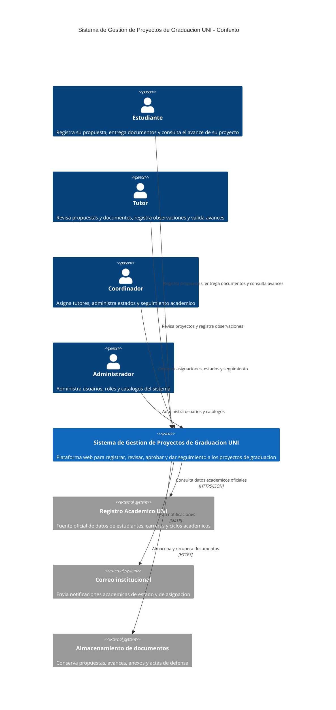
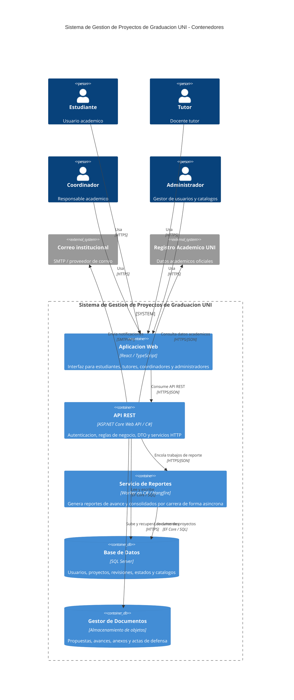
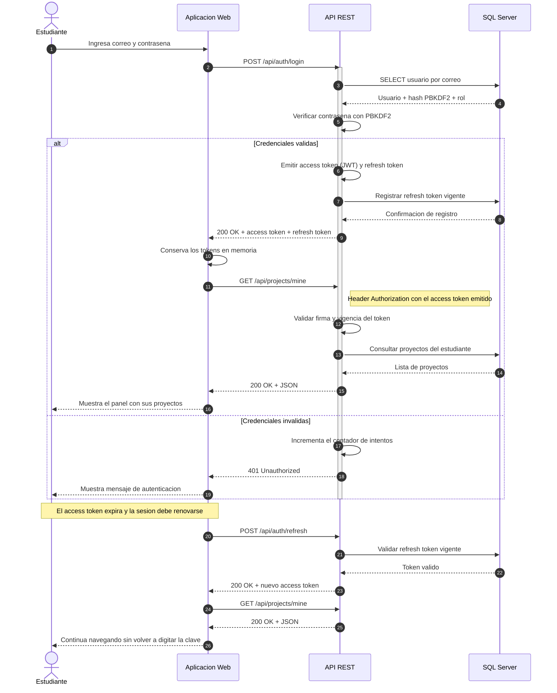
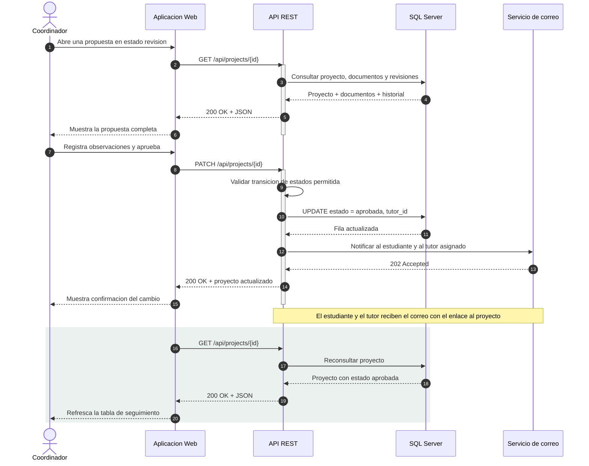

# Sistema de Gestión de Proyectos de Graduación UNI

Plataforma web para registrar, revisar, aprobar y dar seguimiento a los proyectos de graduación de la Universidad Nacional de Ingeniería. Documentada con el **Modelo C4** (niveles 1 y 2), **diagramas de secuencia** y una arquitectura **API-First**, usando **Mermaid** para que la arquitectura quede versionada junto al código.

> Asignatura: Diseño de Sistemas en Internet — Tema: Arquitectura de Sistemas Web con Modelo C4, API-First y Mermaid.

## Problema

Las facultades administran las propuestas de graduación en hojas de cálculo y correo electrónico. Ese flujo no deja rastro auditable: no se sabe quién revisó qué, en qué estado está cada propuesta ni cuándo venció una observación. El sistema centraliza el ciclo de vida del proyecto (propuesta → revisión → aprobada → en desarrollo → defensa → cerrada) y deja cada transición registrada.

## Arquitectura

El proyecto utiliza el Modelo C4 para documentar el contexto y los contenedores principales, complementado con diagramas de secuencia para describir las interacciones API-First.

### C4 Nivel 1 — Contexto



### C4 Nivel 2 — Contenedores



### Secuencia — Login con JWT y refresco de token



### Secuencia — Aprobación de propuesta por el coordinador



## Contrato de la API

La API se diseña antes que la interfaz (API-First). El contrato se expone con OpenAPI/Swagger y se valida antes de implementar los consumidores.

| Recurso | Método | Endpoint | Éxito | Errores principales |
|---|---|---|---|---|
| Autenticación | POST | `/api/auth/login` | 200 | 400, 401 |
| Refresco de token | POST | `/api/auth/refresh` | 200 | 401 |
| Mis proyectos | GET | `/api/projects/mine` | 200 | 401 |
| Proyecto | GET | `/api/projects/{id}` | 200 | 401, 404 |
| Crear propuesta | POST | `/api/projects` | 201 | 400, 401 |
| Actualizar proyecto | PATCH | `/api/projects/{id}` | 200 | 400, 401, 403, 404 |
| Revisión | POST | `/api/projects/{id}/reviews` | 201 | 400, 401, 403, 404 |

## Ejecución

```bash
git clone https://github.com/JhonAlon/graduacion-uni-c4.git
cd graduacion-uni-c4
dotnet restore
dotnet run --project src/Graduacion.Api
```

Swagger queda disponible en `/swagger` una vez levantado el servidor.

## Decisiones técnicas

- **API-First**: el contrato HTTP se define en OpenAPI y a partir de él se genera el cliente de la aplicación web, de modo que frontend y backend evolucionan contra el mismo acuerdo.
- **DTO y separación de responsabilidades**: los controladores quedan delgados; la lógica de negocio vive en servicios, y las entidades de persistencia nunca se devuelven al cliente.
- **Inyección de dependencias**: los servicios se registran en `Program.cs` y se inyectan por constructor, lo que facilita sustituir el almacén de documentos o el proveedor de correo.
- **Autenticación**: contraseñas con PBKDF2 (nunca en texto plano), access token JWT de vida corta y refresh token vigente para renovar la sesión sin volver a digitar la clave.
- **Documentos separados de la base relacional**: los PDF pesados se guardan en un almacén de objetos; SQL Server conserva solo metadatos transaccionales.
- **Arquitectura como código**: los diagramas Mermaid viven en el README, por lo que se versionan y se revisan en el mismo PR que cambia la implementación.
